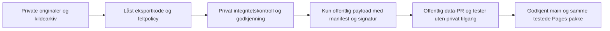

# A1B – privat datalagring og sikker migrering

**Plan til godkjenning, 13. november 2026.** Utgangspunkt: `main faaf61a429f4813e08e20ad21ef15f91143cf4bf`, merge av PR #27. A1s [offentlige eksportmodell](a1-offentlig-dataeksport.md) videreføres uendret. Denne PR-en inneholder bare dokumentasjon og en veiviser i README. Den oppretter ikke repository, gir ikke tilganger, flytter ikke data og sletter/omskriver ingenting.

## Anbefaling og avgrensning

Vurder **`morothon-no/historikk-admin` som privat repository**, med originalregistre, kildearkiv og intern behandlingshistorikk. Navnet er et forslag; verken opprettelse, tilgjengelighet eller tilganger er godkjent. `morothon-no/historikk` skal senere inneholde offentlig kode, godkjente offentlige data og offentlige/syntetiske tester. Privat eksport og offentlig nettstedbygg blir to separate steg.

Det trengs tre beslutninger før overgangen: godkjent privat destinasjon og verifisert backup, [feltvalg P01–P12](a1b-publiseringsbeslutninger.md), og håndtering av den **allerede offentlige historikken**. Å fjerne råfilene fra neste commit eller bruke grunt checkout gjør ikke eldre offentlige versjoner utilgjengelige. En offentlig testjobb kan fortsatt hente slike versjoner uten privat legitimasjon. Det er derfor nødvendig å skille mellom å beskytte **fremtidige private originaler** og å redusere tidligere eksponering; sistnevnte kan aldri garanteres reversert hos alle som allerede har kopier.

## Etterprøvd kartlegging

Kartlagt fra den hentede `main`, annonserte Git-referanser og fire offentlige Actions-sammendrag. Ingen rå personregistre eller interne notattekster gjengis i denne rapporten.

| Flate | Funn på kontrolltidspunktet | Behandling i målbildet |
| --- | --- | --- |
| `data/honors.json` | Inneholder kilder, interne/historiske notater, tidligere merkeforslag, revisjonshistorikk, skjultprofil-policy, godkjenninger og tidligere kontrollbevis. 44 registreringer bevares internt, 43 vises. | Originalen og historikken bevares privat. Samme offentlige filnavn kan senere inneholde **bare den godkjente eksporten**. Skjulte Heder-poster må ikke rekonstrueres fra eksporten. |
| `data/volunteers.json` | Enkel navneliste, reelle dugnadsgrunnlag, kildehenvisninger og interne notater. | Privat original; offentlig liste/sammendrag følger vedtatt feltkontrakt. Profilreferanser skal fortsatt gi én person, ikke duplikater. |
| `docs/v35-personregister.md`, `docs/v352-personregister.md` | Faktiske historiske persontabeller med perioder, antall, fravær og tidligere status. Eldre beskrivelser er ikke nødvendigvis dagens offentlige fasit. | Bevar uendrede originaler og versjoner privat før senere offentlig opprydding. Ikke oppdater en gammel kilde som om den alltid hadde dagens fakta. |
| `docs/v36-tekstforslag.json` | Personlige tekstforslag med kildereferanser og status som avventer godkjenning. At de ikke brukes av nettsiden gjør dem ikke private i Git. | Bevar som intern dokumentasjon. Ikke promoter til aktive persontekster ved migrering. |
| `docs/personregister-v36.md`, `docs/loperkoblinger-v36.md`, `docs/dugnadsmerker-fartstid.md`, `docs/honors.md` | Blanding av generell veiledning, faktiske person-/koblingseksempler, kilde-ID-er og historiske kontrolltall. | Gjennomgå avsnittsvis. Offentlig brukerhjelp kan beholdes med godkjente offentlige eller syntetiske eksempler; administrative kilder bevares privat. Ikke erklær hele dokumentet privat bare fordi det nevner et feltnavn. |
| `docs/v361-sluttkontroll.md`, `docs/skjul-erling-danielsen.md`, øvrige versjons-/revisjonsrapporter | Behandlings-/korreksjonsspor og referanser til faktiske identiteter eller tidligere tilstander. | Klassifiser per opplysning og bevar originaldokumentene. Skjuling på Heder-siden er ikke fjerning av omtale fra dokumentasjonen. Nye offentlige rapporter skal ikke kopiere private avsnitt. |
| Tester og `scripts/` | Flere tester leser råregistre, arkivmedlemmer og ekte personopplysninger; `tests/helpers/honors.cjs` og historiske renderere bruker `git show`/gamle commits. | Skill generiske motor-/layouttester fra private register-/arkivtester. Bevar de private testene, erstatt reelle private offentlige fixturer med syntetiske data etter godkjenning. Ikke hopp over kontroller for å få grønt. |
| Lokale rapporter | `.review/runner-links/` er Git-ignorert og ikke i A1-artefaktet, men inneholder administrativt kontrollgrunnlag når verktøyet kjøres. | Privat arbeidsområde med avtalt tilgang/bevaring; ikke bruk offentlig artefakt, logg eller cache som transport. `.gitignore` er ikke tilgangskontroll. |
| Kildereferanser utenfor filene | Registrene har 9 unike kilde-URL-er: 7 til Issues #11/#13 med ulike kommentarhenvisninger, samt 2 til publiserte avisartikler. | Issue-/kommentarinnhold og vedlegg må kartlegges separat av eier; de forsvinner ikke ved flytting av JSON. Bevar nødvendige kildeversjoner privat etter godkjenning. Eksterne artikler er selvstendige publiseringer; ikke kopier hele artikler eller anta at vi kontrollerer dem. Ingen slike tekster er kopiert hit. |
| Bilder, originalmotiver og vedlegg | 225 sporede filer; ingen PDF/ZIP/CSV/XLSX/DOCX i gjeldende arbeidstre. Historikken på main har 32 PNG/PDF-stier under `review/heder-pr16/`. Andre bilder/masterreferanser må også klassifiseres. | Godkjent offentlig merke-/nettgrafikk beholdes uendret. Historiske personkontroller og originale kildevedlegg gjennomgås privat. Eksterne vedlegg omtalt i kilder er ikke nødvendigvis lagret i Git og må innhentes/verifiseres av eier. Ikke endre medaljefiler eller metadata automatisk. |
| Workflow-kopier | Én aktiv `.github/workflows/pages.yml`; også en inaktiv, feilplassert kopi under en katalog med innledende mellomrom finnes i Git. | Ta med ved arkivering og rydding av konfigurasjon. Den inaktive kopien er ikke en ekstra aktiv workflow eller i seg selv bevis på persondata. Ikke bruk den som gjeldende sikkerhetspolicy. |

Et innholdssøk ga **13 dokument-/vedleggskandidater** til nærmere klassifisering. Det er en søkeliste, ikke bevis for at alle disse filene er private; også generiske revisjonsdokumenter traff. Ingen faktisk personliste er kopiert til denne PR-en.

### Git, grener og tidligere artefakter

- Det annonseres **23 branch-heads, ingen tags og 21 PR-head-referanser**. **16 branch-heads**, inkludert main, har administrative felt i minst ett av de to registrene. Dette er en nedre grense basert på feltmarkører, ikke en full semantisk vurdering av alle dokumenter i alle grener. Antall gjelder før denne dokumentasjonsgrenen pushes.
- Main har **31 dataendrende revisjoner**, hvorav 28 har minst én av de administrative feltmarkørene. Første funn er `92b892aa` fra 10. november 2026. Sletting av en eldre arbeidsgren gjør ikke slike commits utilgjengelige når de fortsatt finnes i main-historikk eller PR-referanser.
- A1-grenen og flere V3.4–V3.6-/revisjonsgrener beholder råregistrene. En gren blir ikke trygg som kilde for rollback fordi den tidligere var godkjent for en annen funksjon.
- Metadata for fire Actions-kjøringer ble lest fra GitHubs offentlige nettsider (HTTP 200); **innholdet i gamle artefakter er ikke lastet ned eller republisert**:

| Kjøring | Tilknyttet revisjon | Artefaktnavn vist i sammendraget |
| --- | --- | --- |
| `43403609822` | Merge av A1, `faaf61a` | `morothon-site` |
| `43401857485` | A1 PR, `e1ccaf4` | `morothon-site`, `morothon-a1-offentlig-kontroll` |
| `43396124742` | Merge av revisjonen, `a447314` | `morothon-site`, `morothon-v36-loperkoblinger` |
| `43393896237` | Revisjons-PR, `1266a86` | `morothon-site`, koblingsrapport og fem V3.5.3/V3.6/V3.6.1/V3.6.2-gallerier |

Navnelisten viser metadata, ikke verifisert nedlastbarhet, fullstendighet, innholdshash eller utløpsdato. `api.github.com` er fortsatt blokkert med `Forbidden`; full oversikt over artefakt-ID-er, forks, tilgangslogger og utløp er ikke verifisert. Repo-eier må hente denne oversikten med godkjent tilgang. A1 stoppet ny opplasting av gamle rapporter, men slettet ingen tidligere filer.

## Foreslått repositorystruktur

Strukturen er et målbilde, **ikke opprettede mapper eller flyttede filer**. I første private kopi beholdes originalformatene; ikke del opp registeret eller generer nye ID-er samtidig med flyttingen.

```text
morothon-no/historikk-admin  [foreslått PRIVAT]
  data/honors.json               originale administrative registre
  data/volunteers.json
  sources/                       godkjent bevarte originalvedlegg/kilder
  internal-docs/                 historiske personrapporter og kildevurderinger
  archive/refs-manifest.json     privat oversikt over bevarte Git-/PR-referanser
  export/                       låst, gjennomgått eksportverktøy og policy
  tests/                        kilde-/integritetstester og private fixturer
  release-journal/              kilde-, policy-, godkjennings- og eksportspor

morothon-no/historikk        [OFFENTLIG målbilde]
  data/                         kun godkjente offentlige JSON-filer
  publication/                  offentlig eksportmanifest og signatur
  assets/, js/, css/, HTML       samme offisielle motiv og design
  scripts/                      bygg/validering fra offentlig kontrakt
  tests/                        offentlige og syntetiske fixturer
  docs/                         offentlig brukerhjelp og ufølsomme planer
```

Original Git-historikk må bevares med commit-ID-er og kjente refs, ikke bare som de to siste JSON-filene. En verifisert privat arkivkopi kan inneholde hele den gamle kodehistorikken før administrative data organiseres videre. GitHub-PR-head-referanser kan ikke forutsettes å kunne pushes som `refs/pull/*` til et nytt repository; arkiver commitene under dokumenterte private referanser og bevar kartleggingen. Hent LFS-objekter der de finnes, og kartlegg vedlegg/artefakter separat. Et Git-bundle alene inneholder ikke nødvendigvis LFS, Actions-artefakter eller eksterne vedlegg.

`data/history.json` forblir godkjent offentlig løpshistorikk og får én definert autoritativ redigeringsflyt. Privat eksport bruker en gjennomgått, eksakt revisjon av denne historikken; det skal ikke bli to uavhengige versjoner som gir ulike årstall og tellinger. Merkeoriginaler og kvalitetsgrunnlag beholder eksisterende filhash; private kildevedlegg må ikke blandes inn i offentlig asset-register.

## Sikker eksport og offentlig bygg



### Privat eksport

En autorisert person starter eksport fra beskyttet privat main med en uttrykkelig godkjent kode-/policyversjon. Ikke checkout og kjør vilkårlig offentlig PR-kode, flyttbar tag eller «latest» i en jobb som kan lese private kilder. Delte motorfunksjoner kan fortsatt være offentlig kode, men oppdateringen til den private kjøringen må være låst til gjennomgått commit og lockfile.

Privat jobb leser originalene og valgt offentlig løpshistorikk som **data**, beregner samme kvalifikasjoner og lager en midlertidig offentlig payload. Kjør skjema-, skjulings-, tekst-/felt-, identitets-, kilde- og dokumentkontroller før godkjenning. En signatur gjør ikke en feil eksport lovlig eller korrekt; operatøren må også gjennomgå offentlig diff. Ufiltrert stdout, råregistre, private screenshots og kilder må ikke havne i offentlige rapporter, cacher eller artefakter.

Anbefalt offentlig manifest: eksport-ID, offentlig policy-/generatorversjon, hash av **offentlig** løpshistorikk, tillatte filnavn og eksportfilenes størrelser/SHA-256. Ikke inkluder privat kildecommit, kildenotater eller hash av små private registre. Koblingen til nøyaktig privat kilderevisjon og godkjennende aktør lagres i privat releasejournal. Uendret kode/policy/inputs skal gi reproduserbar offentlig payload.

For å gjøre godkjent eksport etterprøvbar anbefales en signert manifestfil, eksempelvis Ed25519. Nøkkelen holdes i godkjent privat nøkkellager/beskyttet miljø, aldri i Git. Offentlig verifikasjonsnøkkel, rotasjon og tilbakekalling forvaltes gjennom beskyttet policy. Dette er autentisering av eksporten, **ikke** formell diplomutstedelse eller tildeling av hedersmerker.

### Overføring og offentlig CI

Et separat, beskyttet publiseringssteg mottar **bare den validerte offentlige payloaden**. Et eventuelt bot-/App-token skal ha kort levetid, kun nødvendige rettigheter til det offentlige repositoryet og ikke lesetilgang til privatregisteret. Ikke legg en bred organisasjonshemmelighet i offentlig CI. Hvem som får godkjenne data og starte denne overføringen må vedtas før aktivering.

Offentlig CI skal kunne kjøre på forks/PR-er uten private tokens, privat checkout eller nedlastingsrett til private artefakter. Ikke bruk `pull_request_target` med hemmeligheter og checkout av PR-kode. Unngå at `workflow_run`, cache eller dispatch blir en vei fra ubetrodd kode til privat kjøring. En eventuell melding om en ønsket dataoppdatering er et forslag, ikke en autorisasjon til å lese privatregisteret eller kjøre avsenderens kode.

Offentlig validering bruker publiseringskontrakt og godkjent manifest/signatur, ikke rå originalregistre. Verifikasjonslogikken/nøkkelpolicyen for den beskyttede kontrollen må komme fra betrodd revisjon; en PR som endrer data, nøkkel og validator samtidig skal ikke kunne godkjenne seg selv. Beskytt hovedgren, data-/workflow-endringer og deploymiljø med riktig review og nødvendige statussjekker; faktiske GitHub-innstillinger må verifiseres av eier.

Dagens `build-site.cjs` og `validatePublicSite()` leser originalene. De kan derfor **ikke** bare kjøres uendret etter at kildene er flyttet. Planlagt deling er:

1. Privat `export-admin`: bruker originaler og A1s gjennomgåtte filtre/utvidede policy, beregner og godkjenner offentlig payload.
2. Offentlig `build-public`/validering: godtar kun den offentlige kontrakten, kontrollerer signatur/hash/policy og bygger samme runtime. Ingen fallback til privat filsti eller nettverk ved manglende data.
3. Ikke kjør A1-projektoren en gang til på allerede eksporterte data: dagens kildehåndtak er ikke en kontrakt om idempotent reeksport.
4. `pretest`/`prebuild` må slutte å starte råregisterbasert koblingskontroll i offentlig CI. Historiske `git show`-/`git archive`-tester med administrative data flyttes til privat kontroll. Offentlige tester bruker godkjente offentlige gullreferanser og syntetiske kasus; det finnes fortsatt en full privat integritetskjøring.
5. Offentlig checkout kan bruke grunt snapshot uten historiske råkilder. Dette reduserer unødvendig eksponering i jobben, men gjør ikke gammel offentlig Git-historikk hemmelig. Ingen ny privat legitimasjon skal deles for å få gamle tester til å virke.

## Bevaring av funksjoner og mindre offentlig detaljgrunnlag

Den uendrede A1-pakken viser at nettleseren kan levere 43 synlige profiler og 86 diplomvarianter fra den offentlige eksporten uten tilgang til råregisterets noter/revisjoner. Det er et runtime-bevis, ikke bevis for at dagens bygg og alle tester er frakoblet originalene.

Dagens `serviceTenure()`, `contribution()`, fremhevingsvalidering og `serviceContent()` bruker konkrete årslister til total, periode, grunnlagstype og milepælsdato. Hvis P01/P02 vedtas som minimering, trengs en eksplisitt offentlig sammendragsadapter: eksempelvis basis, antall, første/siste år som allerede vises, dokumentert antall, milepælsår og et prestasjonssnapshot per tilgjengelig diplom. Private beregninger bruker fortsatt de opprinnelige årslistene og samme regler. Ikke fjern listene og erstatt mangler med null, gjetning eller nye årsrekker.

Dette krever videre implementering og bevis for at adapteren gir identiske resultater; det er ikke allerede løst. Nye resultater må utløse ny privat eksport når årsgrunnlaget endres. Manifestets referanse til den offentlige løpshistorikken hindrer at en 2027-oppdatering publiseres med et gammelt 2026-sammendrag. Nettsiden trenger ingen direkte privat nettverksforbindelse for dette.

Navn, person-ID-er, aliaser, kildereferanser og manglende år bevares i originalene. Alle eksisterende offentlige lenker og godkjente løperkoblinger skal fortsatt fungere. Einar beholder 33 godkjente utgaver og dato 7. november 2026 uten konstruerte enkeltår; skjult Heder-profil forblir skjult, mens tilhørende offentlige løperresultater er urørt. «Alle merker»/«Kun siste merke», historisk opptjening, font-/DPI-/layoutporter og forskjellen mellom presentasjon, godkjenning og utdeling består.

Uendret diplominnhold skal beholde eksisterende innholdshash og utskriftsmodus. Hvis en faktisk nødvendig endring påvirker dokumentet, skal bare berørte varianter bli ventende til ny gjennomgang. Ikke regenerer alle godkjenninger for å få grønt, og ikke registrer formelle tildelinger.

## Gjennomføringsrekkefølge med stoppunkter

| Fase | Konkret arbeid | Avhengighet / utgangskrav |
| --- | --- | --- |
| **0 – beslutning** | Godkjenn privat destinasjon, backupmål, ansvarlige, P01–P12 og ønsket tiltak mot gammel eksponering. | Skriftlig avgrensning. Denne dokumentasjons-PR-en er ikke en migreringsfullmakt. |
| **1 – tom privat destinasjon** | Etter egen godkjenning: opprett privat repo, slå av uønsket standardtilgang/forking, etabler team/branch-/miljøregler og kontroller tilgang fra en uautorisert konto. | Ingen originaldata før faktisk privat synlighet og ACL er verifisert. |
| **2 – backup før kopiering** | Bevar komplett Git-objekt-/refgrunnlag, vedlegg, relevante artefakter og godkjenninger i godkjent kryptert backup. Lag privat hashmanifest. | Isolert restore og integritetskontroll bestått; godkjent privat destinasjon finnes. |
| **3 – privat bevaringskopi** | Overfør verifiserte originaler og historikk, også kjente PR-head-commits og eksterne vedlegg som skal bevares. Sammenlign alle registre/ID-er/kontrollsummer. | Ny privat kopi kan gjenopprettes og leses av rette personer. Offentlig kilde fjernes ikke ennå. |
| **4 – skill kode og jobber** | Implementer eksport/bygg-delingen, eventuell sammendragsadapter, offentlig/syntetisk testsett og privat integritetssuite. Konfigurer låst eksport og kontrollert publisering. | Offentlig bygg/test fungerer uten administrative originaler eller private credentials; gamle kildekontroller består privat. |
| **5 – parallell kontroll** | Kjør gammel og foreslått modell på samme frosne grunnlag. Gjennomgå offentlig diff, 43 profiler, 86 diplomvarianter, historikk, merker, tilgang og gjenoppretting. | Null uautoriserte forskjeller; ingen hemmeligheter eller råkilder i offentlig payload/logg/cache. Feltpolicy og manifest godkjent. |
| **6 – godkjent overgang** | Etter eget vedtak: erstatt offentlige kilderegisterfiler med godkjent eksport og flytt klassifiserte administrative dokumenter/testfixturer ut av offentlig arbeidstre. | Privat original/bevis er verifisert bevart. Ingen dobbel autoritativ redigering. Historiske resultater/design er uendret. |
| **7 – eldre eksponering** | Gjennomfør kun særskilt godkjente tiltak mot grener, gamle artefakter, logger, caches og eventuell Git-historikk/repositorydeling. | Tiltakslogg og dokumentert resteksponering. Gammel historikk endres ikke som sideeffekt av fase 6. |
| **8 – drift** | Tilgangsreview, backup/restoreøvelser, oppgraderinger, nøkkelrotasjon og håndtering av korreksjoner. | Eier/stedfortreder kan operere løsningen uten utviklerens personlige kontoer. |

Ingen fase skal slette en original fordi bare en nyere fil finnes. En senere datakorreksjon får nytt, kildebelagt spor. Ved mislykket overgang stoppes publisering og siste **nåværende policyvaliderte offentlige pakke** kan brukes; rollback er aldri å publisere et gammelt råregister eller gjøre det private repoet offentlig.

## Tilgang, backup og restore

- **Tilgang:** arrangør eier private data; navngitte redaktører kan foreslå endringer, godkjennere kontrollerer publisering. Avgrens administratorer og servicekonti til nødvendige oppgaver, krev MFA og gå gjennom tilgang ved rollebytte og jevnlig. Organisasjonens standardtilgang og eventuelle eksterne samarbeidspartnere må kontrolleres.
- **Secrets:** privatnøkler/App-nøkler/backupnøkler lagres i godkjent nøkkellager, ikke Git, dokumenteksempler, PR-tekst eller artefakter. Separat recovery for minst to utpekte personer; dokumentert tilbakekalling og rotasjon. Ikke bruk en utviklers personlige token som driftsforutsetning.
- **Backup:** minst én versjonert privat arbeidskopi og en separat kryptert backup under annen administrativ feilflate, med avtalt bevaring/uforanderlighet. Repo-replikering alene er ikke vern mot feil sletting eller kompromittert konto. Ikke committ en stor backupbundle til det offentlige repoet og kall den privat.
- **Omfang:** Git-objekter/refs, LFS ved behov, originalvedlegg, kilde-/godkjenningsjournal, policy, offentlige eksportpakker, nødvendige maler/assets og eksport-/byggeverktøyversjon. GitHub Issues/PR-vedlegg, artefakter og branch-/miljøregler krever separat eksport/oversikt. Hemmeligheter gjenopprettes via kontrollert nøkkelprosess, ikke ukryptert konfigurasjonsdump.
- **Mål til vedtak:** foreslå daglig backup og før migrering/større import, høyst én dags akseptert datatap og gjenoppretting innen én arbeidsdag. Dette er et forslag, ikke en eksisterende SLA. Kritiske godkjenninger bør i tillegg sikres før de tas i bruk.
- **Restoreprøve:** gjenopprett på isolert, ikke-offentlig maskin/repo; kontroller hashmanifest, refs/commit-ID-er, alle personer/aliaser, godkjenningsbevis og vedlegg. Kjør privat integritetssuite og generer offentlig eksport for sammenligning. Bekreft at en uautorisert konto fortsatt avvises. Gjenta ved større oppgradering og avtalt intervall, eksempelvis kvartalsvis.

## Tidligere eksponering: hva vi kan og ikke kan fjerne

| Flate | Tiltak under vår kontroll, etter godkjenning | Hva tiltaket ikke garanterer |
| --- | --- | --- |
| Gjeldende public main | Erstatt råfiler med eksport, rydd klassifiserte private dokumenter/fixturer etter sikker bevaring. | Eldre commits, PR-er og tidligere nedlastinger forsvinner ikke. |
| Egne grener/tags | Kartlegg og arkiver, og fjern/erstatt bare godkjente refs som fortsatt eksponerer kilder. Ingen tags ble observert nå. | Commitene kan fortsatt nås fra main, andre refs, kloner eller GitHubs cacher. |
| PR-referanser/diff og gamle raw-URL-er | Identifiser berørte refs og be GitHub om råd/fjerning der egen administrasjon ikke er tilstrekkelig. | PR-refs kan ikke forutsettes slettet via vanlig branch-sletting; ekstern tilgjengelighet må etterprøves. |
| Actions og releases | Eier kartlegger faktiske ID-er/utløp. Etter godkjenning kan egne artefakter/logger/releasefiler fjernes og gammel workflow-gjenkjøring begrenses. Bevar nødvendig kopi privat først. | Nedlastede arkiver, eksterne logger og speil kan fortsatt finnes. Ikke anta at en retensjonsverdi har slettet alt. |
| Issues, PR-kommentarer og vedlegg | Eier gjennomgår faktiske kildehenvisninger og vedlegg, bevarer nødvendige versjoner privat og beslutter eventuell redigering/fjerning av egne offentlige administrative opplysninger separat. | Git-klon dekker ikke nødvendigvis disse kildene; gamle sitater, e-postvarsler, editeringshistorikk eller eksterne kopier kan fortsatt finnes. |
| Pages/CDN/cache | Ny filtrert pakke, kontroll av historiske ressurser og eventuell cacheforespørsel hos vert. | Tredjeparts-/nettlesercacher, indekser og nedlastede PDF-er kan ikke tilbakekalles generelt. |
| Forks/kloner og andre kopier | Kartlegg kjente kopier, be eiere om korrigering/fjerning og vurder nødvendig oppfølging med ansvarlig. | Alle kopier kan ikke oppdages eller garanteres slettet. Hash- og ID-endring er ikke en slik garanti. |

For egen Git-historikk må arrangøren velge eksplisitt: **(a)** behold historikken offentlig med dokumentert resteksponering, **(b)** godkjenn målrettet historikkrensing etter privat bevaring og GitHub-avklaring, eller **(c)** etabler ren offentlig historikk og bevar den gamle historikken i privat arkiv. Ved (c) kan også navne-/repositoryomlegging vurderes, men eksisterende PR-/Issue-lenker, repository-ID, Pages-oppsett og `morothon-no.github.io/historikk/` må planlegges særskilt. Ingen av valgene gjennomføres her; ingen gir garanti om sletting av eksterne kopier.

**Anbefaling:** alternativ (a) er bare et midlertidig, uttrykkelig akseptert risikonivå og kan ikke omtales som at gamle administrative originaler er beskyttet. Planlegg (b) dersom bevaring av repository-identitet og eksisterende samarbeidshistorikk veier tyngst; vurder (c) dersom en ren offentlig utgivelsesflate er viktigere. Avklar begge med repo-eier/GitHub før valg, og dokumenter hvordan gamle PR-/Issue-data håndteres. Egen publisering er først ryddet i vedtatt omfang når de berørte egne kildereferansene faktisk er kontrollert etter tiltaket, ikke når en ny filstruktur er committet.

## Vesentlige risikoer og kontrollpunkt

| Risiko | Konsekvens | Kontroll før neste steg |
| --- | --- | --- |
| Flytting omtales som full sletting | Eldre rådata er fortsatt tilgjengelige og saken avsluttes feilaktig | G06 og fase 7: kartlegg egne refs/artefakter og dokumenter resteksponering; ikke gi en generell slettingsgaranti. |
| Ubetrodd offentlig kode kjøres med privat tilgang | Nye originaler kan lekke før et eksportfilter får kjørt | Låst og gjennomgått privat eksportkode, separat publiseringsjobb og ingen privat legitimasjon til offentlige PR-er. |
| Identitet, originalkilder eller godkjenninger går tapt | Personer kobles feil eller diplomer får feil gyldighet | Verifisert backup/restore, privat ref-/hashmanifest og ekvivalenskontroll før offentlig opprydding. Ingen regenerering av person-ID-er eller massegodkjenning. |
| Sammendrag er eldre enn løpshistorikken | Nye år gir feil dugnadstall/milepæler | Manifest binder offentlig historikk og policy til eksporten; stans ved mismatch og produser ny godkjent eksport. |
| Restore eller bot peker på offentlig repo med råarkiv | Administrative originaler republiseres | Adskilte destinasjoner/rettigheter og tillatt filliste. Ingen speilpush av privat arkiv til det offentlige repositoryet; publiser bare godkjent payload via PR. |
| Bare én person kan gjenopprette data/nøkler | Tap av konto gir driftsstans eller uverifiserbar backup | Navngitt stedfortreder, separat nøkkelrecovery og en faktisk gjennomført restoreøvelse. |

## Tester og akseptanse før faktisk migrering

Dette er krav til gjennomføringen, ikke påstander om at privat infrastruktur allerede er testet.

| Test | Må bestås |
| --- | --- |
| Originalintegritet | Antall og bytes/commit-ID-er/kilder stemmer med verifisert privat manifest. 44 interne personer er bevart, 43 er synlige. Ingen nye ID-er, aliaser, fravær eller årsrekker. |
| Offentlig funksjon | Samme personkort/søk/profillenker, merkesamlinger og beregninger på mobil og PC. Skjult Heder-post mangler også i JSON, men den offentlige løperprofilen er urørt. |
| Diplomer | 86 varianter med samme historiske antall, periode, dato, tekst, grafikk og innholdshash/utskriftsmodus. Representative PDF-er er én liggende A4-side med innebygde fonter. Ingen ny formell tildeling. |
| Løp og fremtidige år | `history.json`, navnekorrigeringer, fire rekorder, stafett, milepæler og Adelskalender består. En 2027-fixture gir nytt eksportgrunnlag uten dobbeltelling og uten å flytte gamle milepæler. |
| Ingen privat avhengighet | Fra isolert offentlig snapshot, uten råregistre og private tokens: installasjon, offentlig test og bygg fungerer. Ingen historiske private `git show`-/`archive`-fallbacks eller privat nettverksforespørsel. |
| Angrep mot grensen | Fork-PR, endret generator, manipulerte manifest/hash/signatur, skjult ID, privat felt, ekstra fil og feil publiseringsscope kan ikke gi en godkjent produksjonspakke. Ubetrodd kode kan ikke selv endre tillitspolicyen for sin påkrevde godkjenning. |
| Oppdatering | Endret tekst/kilde/skjuling eller løpshistorikk gir riktig diff og ugyldiggjør utdatert eksport eller berørte diplomgodkjenninger. Nye kilder kommer ikke inn via en offentlig persons direkte filredigering. |
| Tilgang og restore | Uautorisert konto, tidligere samarbeidspartner og offentlig CI har ingen privat tilgang. Backup gjenopprettes isolert, riktig eier kan drifte den, og rollback respekterer gjeldende skjuling. |
| Historisk eksponering | Eier kontrollerer at vedtatte tiltak faktisk har effekt på egne refs/artefakter/URL-er og registrerer kjente/unavklarte eksterne kopier. Ingen «alt er slettet»-attest uten grunnlag. |

### Kontroll utført i denne dokumentasjonsjobben

`npm run build` bestod med **58 filer og samme `e3c0397f3cc7799f`** som A1. `npm run public:kontroll` bestod. `node --test tests/public-export.cjs tests/site-build.cjs` bestod **7/7**, inkludert 43 profiler, 86 diplomvarianters bevaring og kontroll av offentlig runtime. A1s 221/221 er det tidligere full-regresjonsgrunnlaget; hele den uendrede pakken er ikke kjørt om igjen for denne dokumentasjonsendringen. Ny privat CI, minimert sammendragsmodell og restore mot privat lager er **ikke implementert eller testet**.

Alle 58 byggefiler er også sammenlignet byte for byte med A1s kontrollbygg. Sporede filer utenfor README/de to nye planene er identiske med hentet main. De 16 interne dokumentlenkene, kodeblokkene og `git diff --check` er kontrollert uten feil.

## Hva kan gjøres uten nye tilganger?

| Arbeid | Tilgang/godkjenning | Utført her? |
| --- | --- | --- |
| Kartlegging, beslutningsliste, arkitektur og testplan | Eksisterende lesetilgang og dokumentasjonsgren | Ja. Ingen nye private datakopier i PR-en. |
| Kontroll av A1-bygg og offentlig funksjon | Dagens kode/miljø | Ja, som oppgitt over. |
| Utvikle separat offentlig byggekode/validering og syntetiske testfixturer | Kan gjøres uten privat tilgang, men krever et eget implementeringsoppdrag og vedtatt kontrakt | Nei. Dagens byggeregler er uendret. |
| Privat repo, team, nøkler og backupmål | Eiergodkjenning og nødvendige org-/lagringstilganger | Nei. |
| Originalbackup, restore, kopiering og migrering | Godkjent privat destinasjon, sikker backup og særskilt klarsignal | Nei. |
| Historikk-/branch-/artefakttiltak og eventuell repositoryomlegging | Egne eksplisitte vedtak, repo-/org-administrator og eventuelt GitHub-støtte | Nei. |

**Neste beslutning:** vedta feltvalgene og privat destinasjon/backupansvar. Deretter kan et separat oppdrag etablere og verifisere tom privat lagring og implementere den nye byggegrensen. Ikke flytt originaler, slett historikk, endre personopplysninger eller aktiver overføring som del av godkjenning av denne planen alene.
