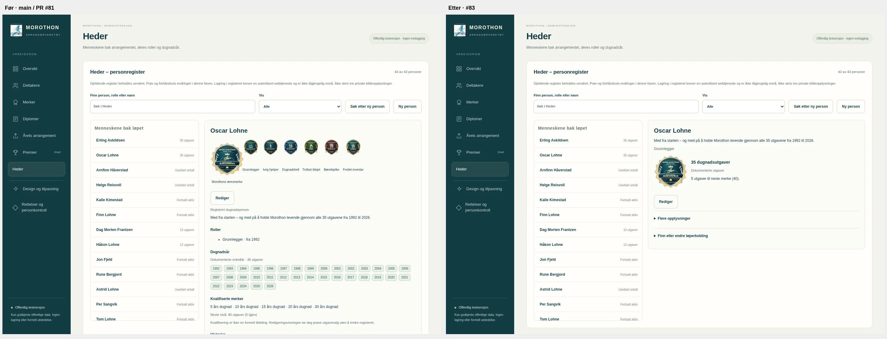
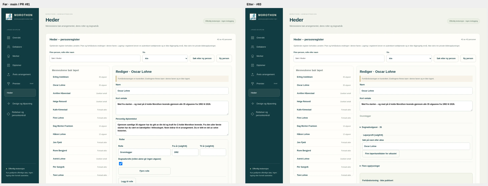
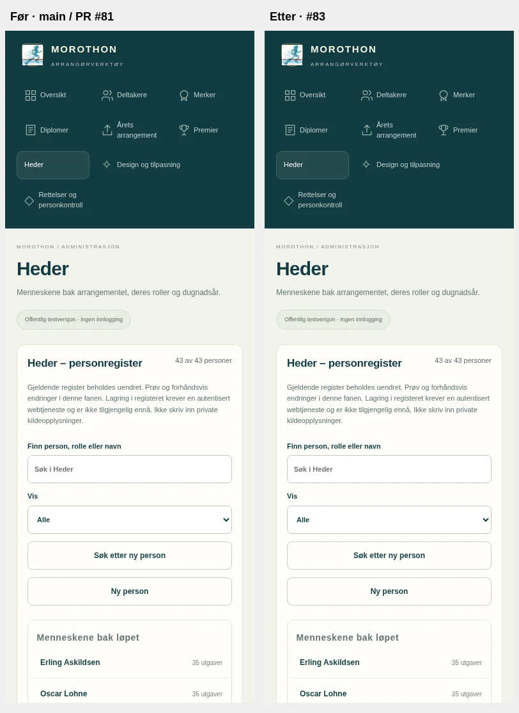

# Heder-personkort – enklere standardvisning (#83)

Bygger på merget #81, main `0e5e03dee71cb8c06725a1ce25ce7f04bb67c6db`.
Samme nettportal, beregningsmodell, datagrunnlag og utkastflyt beholdes.

## Vanlig bruk

- Personkortet viser navn, kort omtale, oppsummerte roller, hovedmerke, antall
  dugnadsutgaver og neste merke. «Rediger» åpner navn og omtale; de øvrige
  opplysningene er lesbare eller sammenlagt inntil de trengs.
- «Dugnadsutgaver» åpner et kompakt rutenett. Fravær ligger i en egen sekundær
  seksjon. Periodehjelp, grunnlag og spesialroller finnes under «Flere opplysninger».
  Dokumenterte utgaver, periodeforslag og godkjent total er fortsatt ulike grunnlag.
- Historier/kilder, diplomtekst, medaljesamling og kontrollinformasjon beholdes.
  Klikk «Rediger …» inne i ønsket seksjon for å vise skrivefeltene. Skjuling/visning
  endrer ingen feltverdier; alle felt forblir montert og inngår i samme modell.
- Dødsår, minnetekst og minnekontroller vises ikke som standard. Eksisterende
  minneprofiler har «Minneopplysninger» under flere opplysninger. På en ordinær
  person må man eksplisitt velge «Åpne minneopplysninger»; dette markerer ikke
  automatisk personen som en minneprofil. Eksisterende minnemerker beholdes.
- Native sammenleggbare seksjoner og årvalg kan brukes med tastatur. Skjuling er
  ikke sletting; fjerning av innhold og forkasting beholder sikkerhetsbekreftelser.

## Finn løperen og velg navn

Bruk «Søk etter ny person», eller «Finn eller endre løperkobling» på et personkort.
Søk på navn/alias og velg kandidat. Kandidatene viser kanonisk navn, aliaser,
løpsdeltakelser/år og koblingsstatus. Profil-ID er tilgjengelig som detalj.

En ny kobling krever uttrykkelig bekreftelse på at dette er samme person.
Deretter kan man velge **«Bruk navn fra løperprofil»**. Heder-navn og løpernavn
vises før valget. «Behold Heder-navnet» kan gjenopprette navnet som stod før
kopieringen; koblingsvalget beholdes. En allerede bekreftet kobling krever ikke
samme bekreftelse på nytt bare for å velge navnevisning.

Kandidatvalg kopierer aldri navn automatisk. Bare navnefeltet kopieres ved
navnehandlingen; omtale, roller, historier, kilder, dugnadsår og merker beholdes.
Ingen resultater, aliaser, person-ID-er eller løperidentiteter slås sammen.
Personer uten løpshistorikk kan fortsatt opprettes som utkast uten kobling.

**Kobling og navn er fortsatt bare utkast.** Nettversjonen lagrer ikke persondata
varig. #82 skal prioritere faktisk sikker lagring/redigering, med resultatimport
og personkorrigeringer først. Denne UX-rettelsen innfører ingen skriverettigheter,
ny tjeneste eller falsk lagreknapp.

## Faktiske før/etter-bilder

Bildene er tatt fra ekte, statiske bygg av #81 og arbeidsversjonen, med samme
godkjente offentlige datapakke og Oscar Lohne som eksempel. Begge sider viser
samme skjermbredde og øverste del av skjermen. Ingen AI-bilder eller redesign av
medaljer er brukt. Alle råskjermbilder og mål kan regenereres med utviklerverktøyet:

```sh
CHROMIUM_PATH=/usr/bin/chromium node scripts/review-heder-cards.cjs /tmp/heder-kontroll 0e5e03dee71cb8c06725a1ce25ce7f04bb67c6db
```

Dette er et kortvarig QA-verktøy, ikke en lokal administrasjonsløsning for
arrangøren. Det kopierer bare godkjente offentlige byggefiler til en midlertidig
mappe, serverer på loopback under kontrollen og avslutter etterpå. Ingen originale
administrative registre, nøkkel eller privat kildearkiv leses/kopieres.

| Oscars kort | Før, høyde | Etter, høyde |
| --- | ---: | ---: |
| Personkort PC (1440 px) | 1119 px | 425 px |
| Redigering PC (1440 px) | 3804 px | 1143 px |
| Personkort mobil (390 px) | 1445 px | 435 px |
| Redigering mobil (390 px) | 4581 px | 1322 px |

Antall synlige tekst-/søkefelt i redigeringen går fra 12 til 3. Tallene gjelder
standardvisningen i dette eksemplet, ikke utvidede seksjoner.







De tre komprimerte sammenligningene er dokumentasjonsvedlegg, ikke runtime-filer.
Store PNG-er/PDF-er, lokale utkast og kontrollmapper følger ikke PR-en.

## Regresjon og datagrense

- 43 personer inkludert 3 minneprofiler beholdes; historisk feilregistrert person
  gjeninnføres ikke. Skjulte skjemaer roundtripper alle 43 personers felter uten
  endringsdiff. UI-serialiseringen følger modellens eksisterende feltrekkefølge.
- Tester dekker eksplisitt ny kobling/navnekopiering, valgfritt Heder-navn,
  allerede bekreftet kobling, fravær, to utgaver samme kalenderår, tastatur,
  kollapsede verdier, XSS og visning ved 1440/768/390 px.
- Ingen endring i datamodell, kildefiler, historiske resultater, profiler,
  diplom-/medaljeoriginaler, offentlig manifest, backend, A1C/B1-sperrer eller
  GitHub Actions. Offentlig Heder-meny og admin forblir skjult.
- Målrettet: 26 nettlesertester og 35 Heder-/modelltester bestått før full regresjon.
  Full testkjøring på eksakt slutt-SHA og GitHub CI dokumenteres separat i PR-en;
  det er ikke påstått at denne grenen er merget eller publisert.
