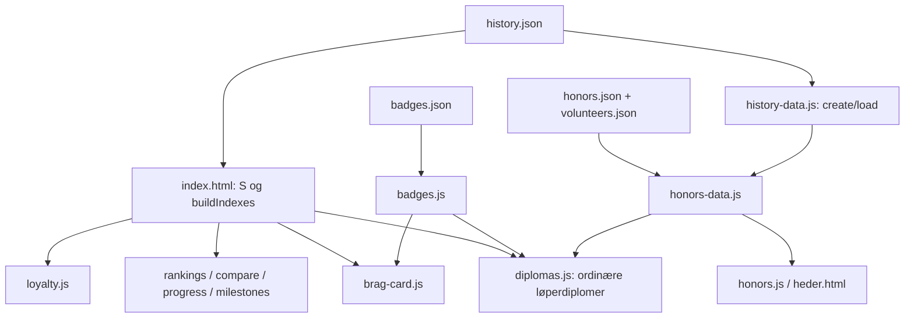

# 01 – Arkitektur og teknisk gjeld

**Revisjonsgrunnlag:** main `53f8f50` (12. november 2026). Dette dokumentet beskriver observasjoner og forslag; ingen runtime-filer er endret. Se [oppsummeringen](00-oppsummering.md), [regelgjennomgangen](02-beregninger.md) og [målemetoden](05-drift-og-sikkerhet.md#målinger-og-avgrensning).

## Faktisk oppbygning

To statiske HTML-innganger deler tolv JavaScript-filer og fire eksterne CSS-filer. Det finnes ingen applikasjonsserver, database, resultatimport eller innlogget administrasjon i dette repositoryet. `package.json` har ingen produksjonsavhengigheter og én direkte utviklingsavhengighet, Playwright 1.62.1. Node brukes til bygg/test, ikke til å betjene den offentlige løsningen. Python/Pillow, Chromium, Poppler og fonter brukes i kontrollverktøyene.

| Del | Målt/observert størrelse | Ansvar og binding |
| --- | --- | --- |
| `index.html` | 348 018 byte; 1 105 linjer | Markup, 100 925 byte innebygd CSS og 110 561 byte innebygd JS; fire base64-forekomster, også grafikk. Linjetall alene undervurderer størrelsen. |
| `js/history-data.js` | 5 448 byte; 47 linjer | Status, personomdirigering, tid/distanse, deltakelsesår, plassering og løperstatistikk. |
| `js/loyalty.js` | 3 244 byte | Deltakelsesperioder, 70/90/100-grenser, historisk heder, rekker og comeback. |
| `js/diplomas.js` | 61 509 byte; 651 linjer | Løper- og hedersdiplomer, datoer, bildekontroll, dokumentmodell, forhåndsvisning, layout og utskrift. |
| `js/honors-data.js` / `js/honors.js` | 28 605 / 25 164 byte | Hedersregister, kildekontroll, dugnadsberegning, personkort, historier og diplom-UI. |
| `js/brag-card.js` | 18 230 byte | Felles modell for profilens hederskort og canvas-eksport; DOM og canvas er to renderere. |
| Øvrig JS | Seks filer: rangering, sammenligning, tidsutvikling, milepæler, navigasjon og merker | Rangering, sammenligning, tidsutvikling, milepæler, felles merkeregister og menyer. |
| `data/history.json` | 929 408 byte; ca. 145 kB ved lokal gzip-beregning | 2 643 personer, 6 914 resultatrader, 35 årganger, 40 aliasoppføringer, 37 ID-omdirigeringer og fire stafettlag. Gzip-tallet er ikke målt CDN-overføring. |

Avhengighetene er hovedsakelig globale navn og skriptrekkefølge, ikke eksplisitte modulimporter:



Eksempel: `js/milestones.js` bruker `S`, `PARTICIPATION_BADGES`, `startedYears`, `yearView` og `openProfile` fra sidekoden. `compare.js`, `progress.js`, `rankings.js` og `brag-card.js` har tilsvarende bindinger. At en fil er ekstern betyr derfor ikke at funksjonen er uavhengig av `index.html`.

## Funn og anbefalinger

Arbeidsomfang i tabellene er **persondager (pd)**, med kjennskap til dagens kode og uten ny funksjonsbestilling. Estimater overlapper mellom dokumentene og skal ikke summeres ukritisk. Alvorlighet gjelder dagens tjeneste når ikke «produkt» er angitt.

| ID / type / alvorlighet | Fil/modul og faktisk observasjon | Anbefalt løsning og forventet effekt | Gjennomføringsrisiko | Omfang | Avhengigheter |
| --- | --- | --- | --- | --- | --- |
| A-01 · forbedring · middels | [`index.html:805`](../../index.html#L805) kombinerer tilstand, beregning, HTML-strenger og hendelser; CSS og bildeinnhold gjør filen stor. | Flytt først **uendret** kode til navngitte moduler og temaressurser. Deretter innfør eksplisitte innganger; mindre endringsflate og enklere vedlikehold. | Middels: skriptrekkefølge, globale `const` og hendelser kan endres ved flytting. Bevar oppførsel med referansetester. | 5–10 pd for første uttrekk, ikke hele produktet | Testnivåene i S-04; ikke nytt rammeverk |
| A-02 · risiko · høy for produkt | [`index.html:815–845`](../../index.html#L815) og [`history-data.js:23`](../../js/history-data.js#L23) bygger to beslektede indekser/modeller. Flere forbrukere beregner egne delmengder. | Én revisjonsbundet historikkmodell og rene beregningsfunksjoner. UI og dokumenter mottar eksplisitte modeller. Motvirker ulik telling og utilsiktet gjenberegning. | Høy: små regelavvik kan forandre historiske tall. Ingen stille normalisering. | 8–15 pd, del av første motoruttrekk | R-01–R-04, Morothon-adapter og kontrakttester |
| A-03 · forbedring · lav nå | [`history-data.js:45`](../../js/history-data.js#L45) og `badges.js` deler en promise per side og nullstiller ved feil. Heder lastet historikken én gang, men kalte `stats()` 55 ganger ved 43 kort. | Behold delte lastinger; mål før eventuell memoization per `datasetRevision + personId + policyVersion`. Ingen global cache uten invalidasjon. | Lav–middels: feil cache kan vise gammel statistikk etter import. | 1–3 pd ved påvist behov | Eksplisitt revisjons-ID; ytelsesmål |
| A-04 · produktbegrensning · høy | [`rankings.js:7`](../../js/rankings.js#L7), [`progress.js:17`](../../js/progress.js#L17), [`index.html:983`](../../index.html#L983) bruker bestemte løpsnavn, 2014-skille og fire rekordkategorier. | Flytt konkurranser, løypeperioder og regler til en validert arrangørprofil; Morothon beholder dagens verdier. Åpner for flere arrangører uten kodegrener. | Høy dersom displaynavn forveksles med historiske kategorier. | 5–10 pd etter modelluttrekk | I-01/I-03, M-01 |
| A-05 · styrke · ingen feil | [`build-site.cjs`](../../scripts/build-site.cjs) bruker eksplisitt filutvalg, tom utmappe, deterministisk innholdshash og samme cacheversjon i iframe-CSS. Ingen runtime-avhengighet til npm. | Behold mekanismen. Tilpass publiseringsutvalget til offentlig projeksjon og moduler, ikke erstatt den med en server uten behov. | Lav ved bevaring; høy ved utvidelse av private data | 0 pd for bevaring; projeksjon i S-01 | S-01; distribusjonsmanifest |
| A-06 · dokumentert dokumentasjonsfeil · lav | [`README.md`](../../README.md) sier at `codex/**`-push kjører Actions; aktiv workflow gjør det ikke. Rotens `pages.yml` er en gammel kopi, ikke en aktiv workflow. | Oppdater dokumentasjon og avklar arkivering av den døde kopien i egen endring. Reduserer feilsøking og misforståelser om publisering. | Lav; ikke endre fungerende trigger uten beslutning | 0,5–1 pd | Bekreftede workflow-regler |

## Teknologivalg

**Anbefaling: behold statisk offentlig publisering og nettleser-JavaScript.** Målingene gir ikke grunnlag for å kreve database eller server på lesesiden. ES-moduler og gradvis tydeligere datastrukturer gir den viktigste gevinsten først. JSDoc med `checkJs` kan innføres før eventuell TypeScript-konvertering.

| Alternativ | Konkret gevinst | Kostnad/ulempe | Anbefaling |
| --- | --- | --- | --- |
| Native ES-moduler, eksisterende DOM/CSS | Eksplisitte avhengigheter, fortsatt enkel statisk drift | Global kode må flyttes kontrollert | Førstevalg; bygg kan kopiere eller pakke ved faktisk behov |
| TypeScript for motor/import | Sterkere kontrakter for status, edition-ID, resultater og revisjoner | Kompilering, gradvis migrering og mer kompetansekrav | Vurder etter datakontrakten; ingen total omskriving nå |
| React/Vue/Svelte i administrasjonen | Kan lette mange redigeringsskjemaer og tilstandsovergangene i import | Ny runtime, bygg og vedlikeholdsflate | Pilotavhengig; vurder administrasjon separat fra offentlig side |
| Next.js/SSR for hele siden | Kan gi serverrendret profil-SEO og samlet serverapp | Pålegger drift og migrering der behovet ennå ikke er dokumentert | Ikke anbefalt som startpunkt; statisk profilgenerering kan dekke SEO |
| Database på lesesiden | Serverfiltrering av langt større datasett | Drift, backup, autentisering og ekstra feilflater | Ingen dokumentert nødvendighet nå |

Administrativ lagring og ekte rettighetskontroll er et annet behov enn offentlig leseytelse; se [05](05-drift-og-sikkerhet.md). Et slikt kontrollplan kan være lite og valgfritt ved selvdrift.

## Foreslått målstruktur

```text
packages/
  domain/           # identiteter, resultater, policy, kvalifikasjoner; ingen DOM
  import/           # normalisert staging + adaptere + endringsforslag
  public-web/       # søk, arkiv, rangering og profiler
  modules/          # badges, loyalty, diplomas, sharing, compare, series, honors
  templates/        # temaer og dokumentrenderere
  admin/            # redigering, validering og publiseringsflyt
organizers/
  morothon/
    config/         # validert profil, regler, tema og modulvalg
    public-input/   # tillatte offentlige opplysninger
private-data/       # separat, tilgangsstyrt lager; IKKE offentlig Git-repo
test-fixtures/
  morothon/         # godkjent referansegrunnlag, med klare rettigheter
  generic/          # små syntetiske kontraktssett
release/            # kun generert offentlig pakke
docs/               # installasjon, drift, schemas, migrering og lisensvilkår
```

Mapper er logiske grenser, ikke et krav om workspaces, bundler eller microservices. Start med få moduler og én prosess der det trengs. Flytt aldri interne data til en mappe kalt `private` i et offentlig repository og anta at navnet beskytter dem.

En trygg migrering bruker en **Morothon-adapter** som leser dagens filer uten å endre dem. Sammenlign først gammel og ny motors utdata, deretter byttes én forbruker om gangen. Side- og diplompresentasjon kan bevares mens motoren trekkes ut.
