# PR #16 – faktisk visuell gjennomgang

Alle bilder er gjengitt direkte fra SVG-filene i denne grenen med Chromium. Ingen AI-illustrasjoner eller plassholdere. Alle merker er designutkast; ingen nye tildelinger og ingen offentlig utskrift/PDF.

[Tidligere utkast før justeringen](foer-forbedringer.png) · [Kort vurdering og tester](VURDERING.md)

## Alle ni merker

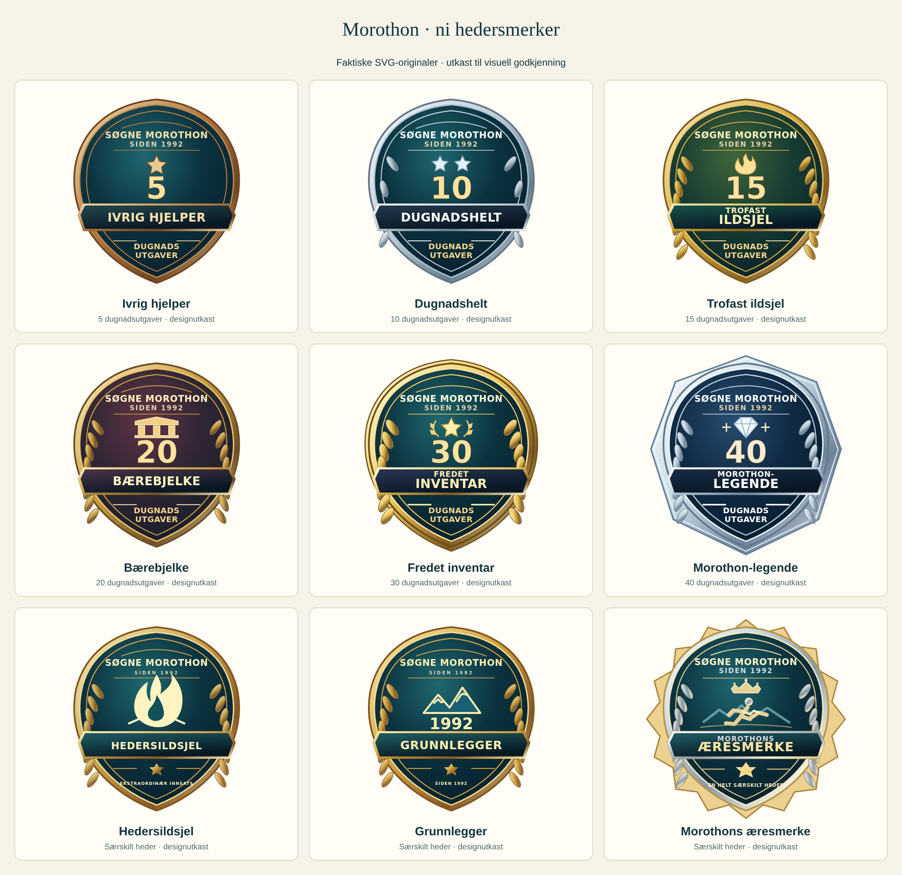

## Seks nivåer i lik størrelse

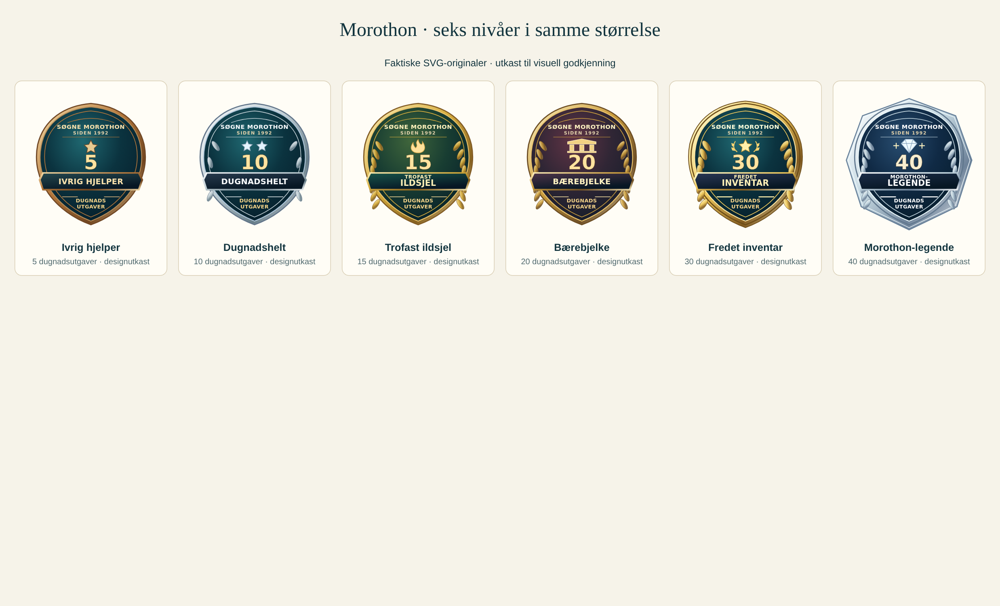

## Nærbilder

### 20 dugnadsutgaver

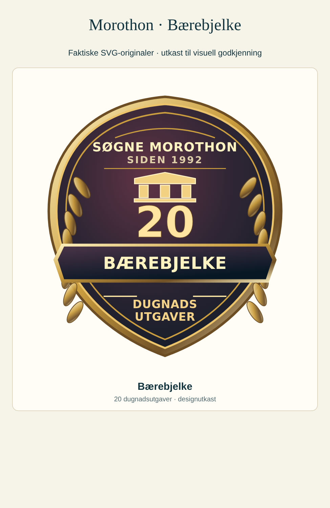

### 30 dugnadsutgaver

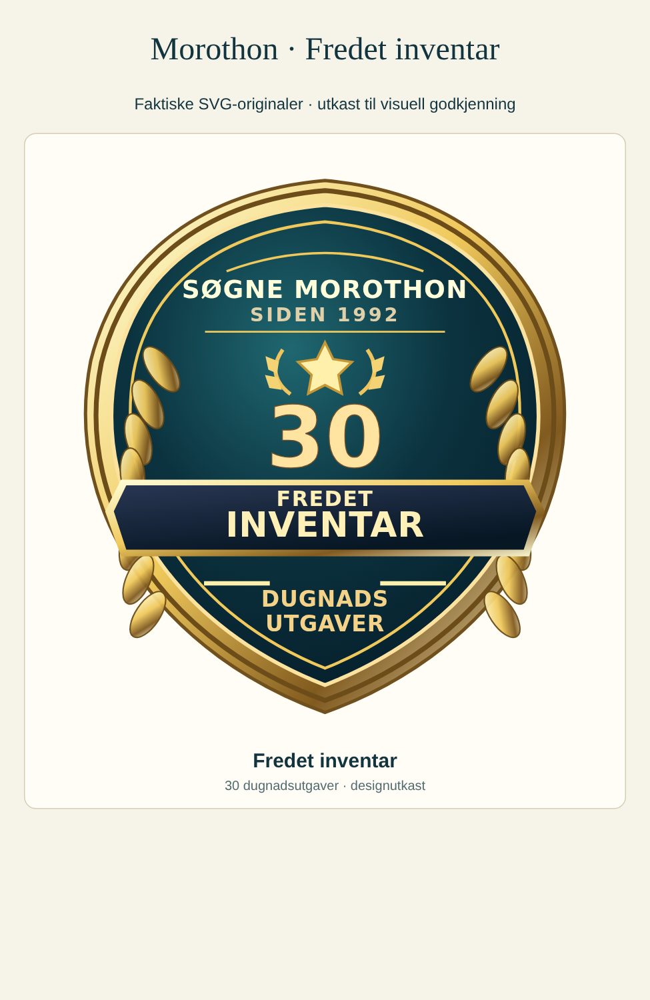

### 40 dugnadsutgaver

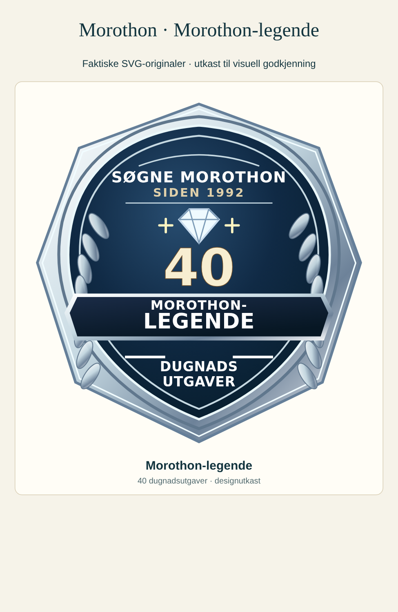

## Mobil og PC

[Merker på mobil](merker-390.png) · [Merker på PC](merker-1440.png)

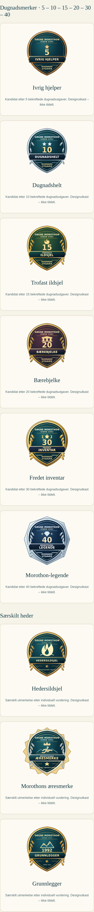

[oscar-lohne: mobil](oscar-lohne-390.png) · [PC](oscar-lohne-1440.png)

[erling-askildsen: mobil](erling-askildsen-390.png) · [PC](erling-askildsen-1440.png)

## A4 – utkast, ikke utdelt

Datoer på navngitte milepæler er løpsdatoer, ikke formelle tildelingsdatoer. Anonyme eksempler har tom dato.

### Ivrig hjelper · En av Morothons dugnadshelter · 5 utgaver

[PDF – utkast, ikke utdelt](dugnadshelt-fem-A4-UTKAST-IKKE-UTDELT.pdf)

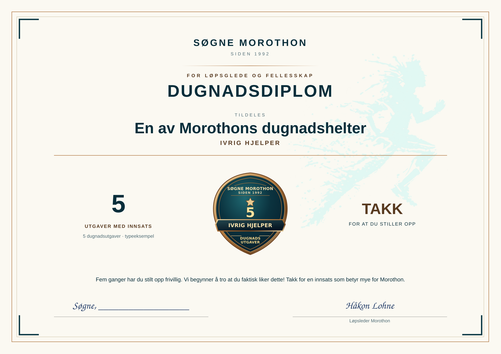

### Dugnadshelt · En av Morothons dugnadshelter · 10 utgaver

[PDF – utkast, ikke utdelt](dugnad-10-A4-UTKAST-IKKE-UTDELT.pdf)

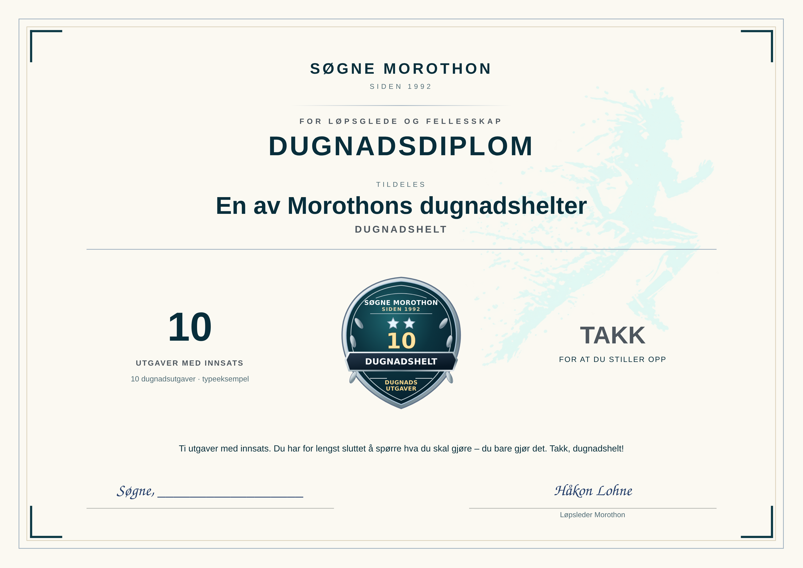

### Trofast ildsjel · En av Morothons dugnadshelter · 15 utgaver

[PDF – utkast, ikke utdelt](dugnad-15-A4-UTKAST-IKKE-UTDELT.pdf)

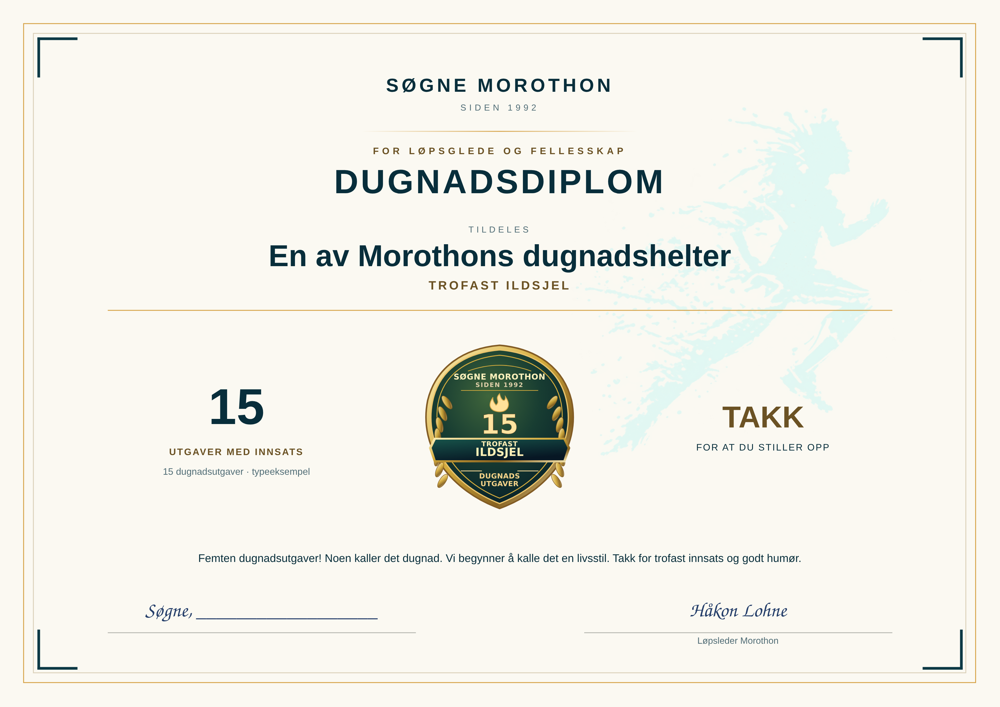

### Bærebjelke · En av Morothons dugnadshelter · 20 utgaver

[PDF – utkast, ikke utdelt](dugnad-20-A4-UTKAST-IKKE-UTDELT.pdf)

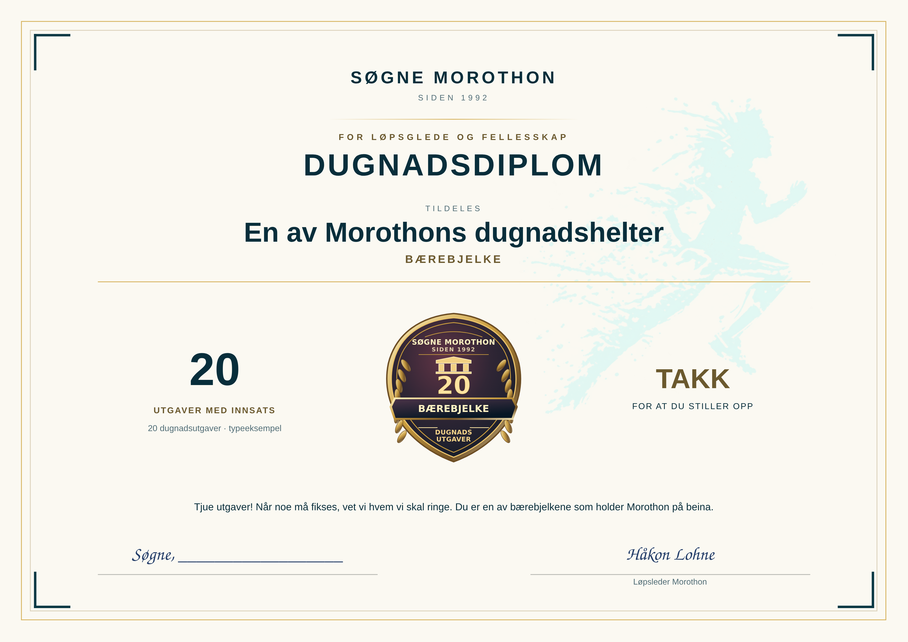

### Fredet inventar · En av Morothons dugnadshelter · 30 utgaver

[PDF – utkast, ikke utdelt](dugnad-30-A4-UTKAST-IKKE-UTDELT.pdf)

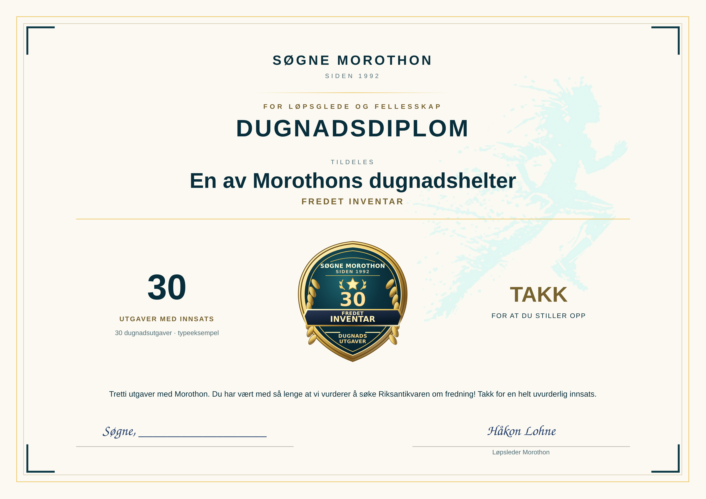

### Morothon-legende · En av Morothons dugnadshelter · 40 utgaver

[PDF – utkast, ikke utdelt](dugnad-40-A4-UTKAST-IKKE-UTDELT.pdf)

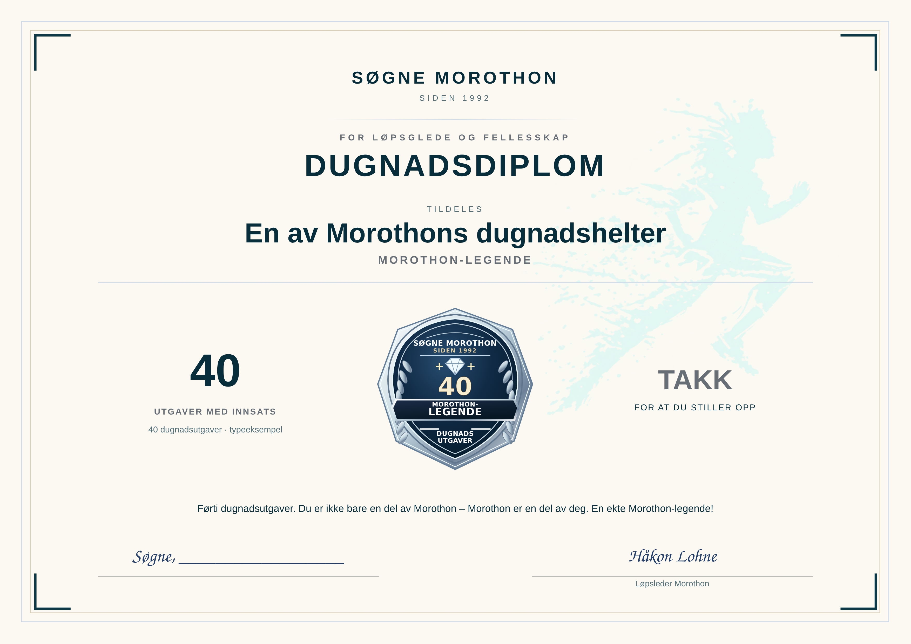

### Fredet inventar · Oscar Lohne · 30 utgaver

[PDF – utkast, ikke utdelt](oscar-30-A4-UTKAST-IKKE-UTDELT.pdf)

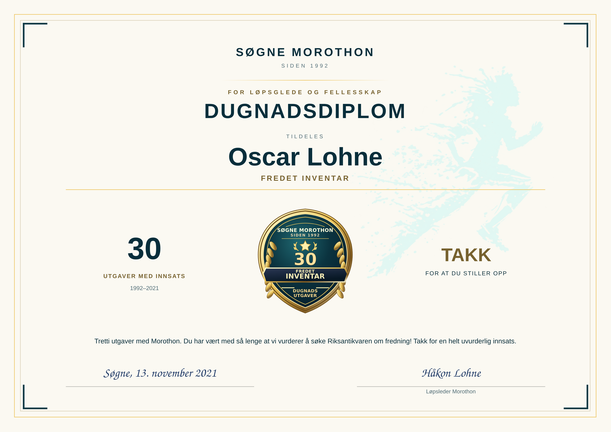

### Fredet inventar · Erling Askildsen · 30 utgaver

[PDF – utkast, ikke utdelt](erling-30-A4-UTKAST-IKKE-UTDELT.pdf)

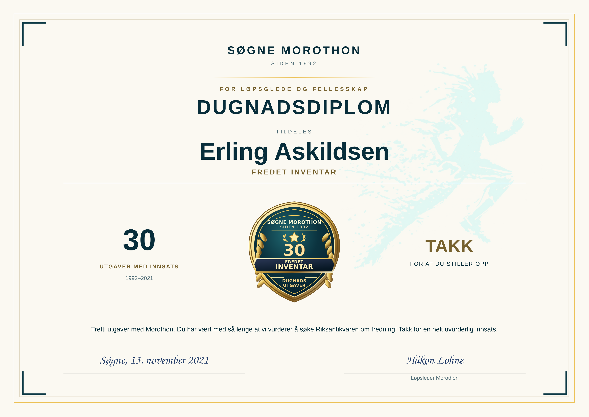

### Morothons æresmerke · Oscar Lohne · 35 utgaver

[PDF – utkast, ikke utdelt](oscar-35-A4-UTKAST-IKKE-UTDELT.pdf)

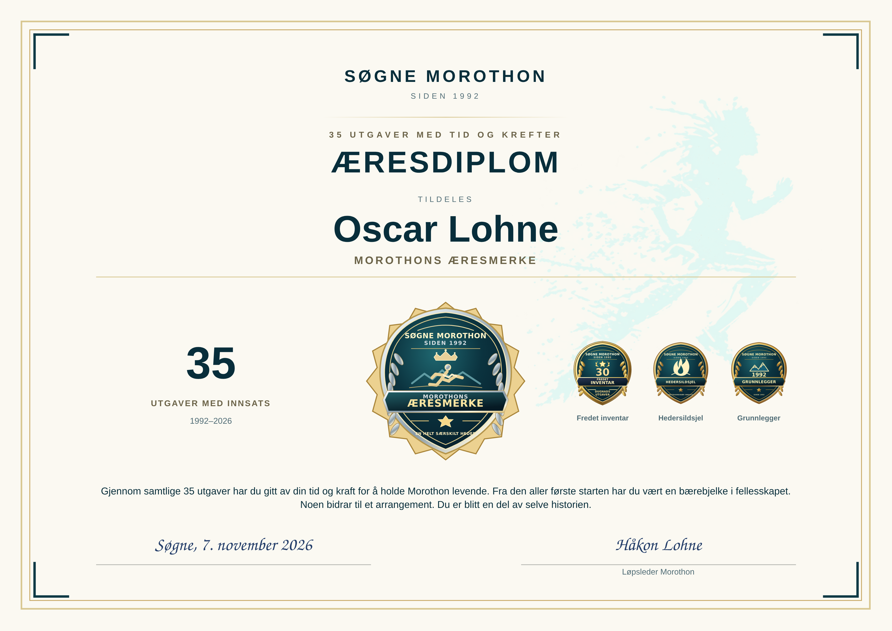

### Morothons æresmerke · Erling Askildsen · 35 utgaver

[PDF – utkast, ikke utdelt](erling-35-A4-UTKAST-IKKE-UTDELT.pdf)

## Målinger og vurdering

[Maskinlesbare kilder, SHA-256, tekstgrenser og A4-resultater](kontroll.json). [Vurdering og testresultater](VURDERING.md).
